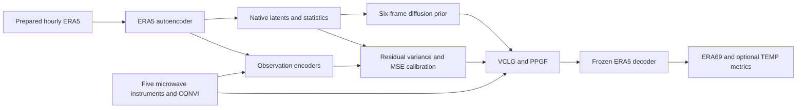

# RISDA

Code for **RISDA: Reliability-Informed Score-based Data Assimilation of
Multi-Source Atmospheric Observations**. RISDA combines observation-to-latent
mapping (O2L), Variance-Calibrated Latent Guidance (VCLG), and Priority-Preserving
Gradient Fusion (PPGF).

This source checkout includes ERA5 autoencoder training, latent export and
normalization, diffusion-prior training, observation encoders, calibration,
assimilation, and evaluation. Prepared data and trained weights are supplied
separately. 

[Pipeline](docs/pipeline.md) · [Data](docs/data.md) ·
[Training](docs/training.md) · [Methods and calibration](docs/protocols.md) ·
[Validation](docs/validation.md) · [Source notices](NOTICE.md)

## Installation

Use Python 3.11 with CUDA-compatible PyTorch 2.5.1 and xFormers 0.0.28.post3.
Run commands from this source checkout; launchers use files in the checkout.

```bash
python -m pip install -e '.[dev]'
cp configs/paths.env.example configs/paths.env
# Edit the data, model, normalization and output paths before sourcing.
source configs/paths.env
python -m risda check
```

W&B is disabled by default. Environment files are loaded explicitly.
Observation models and fusion APIs live in `risda.models`; numerical
infrastructure lives in `appa`. Parameter names are preserved for checkpoint
compatibility. Distribution terms and third-party references are in [NOTICE.md](NOTICE.md).

## Pipeline



The default sources are **ATMS, AMSU-A, MHS, MWTS, MWHS, and CONVI**.
CONVI uses all valid QC surface observations. TEMP is an optional independent
upper-air evaluation product and does not participate in guidance.

## Train

```bash
python -m risda train 128 8 --stop-after ae --output "$RISDA_OUTPUT_ROOT/training" --dry-run
python -m risda train 128 8 --stop-after ae --output "$RISDA_OUTPUT_ROOT/training"
python -m risda train 128 8 --skip-to dump --stop-after stats --output "$RISDA_OUTPUT_ROOT/training"
python -m risda train 128 8 --skip-to diffusion --stop-after diffusion --output "$RISDA_OUTPUT_ROOT/training"
python -m risda train 128 8 --skip-to satellite --output "$RISDA_OUTPUT_ROOT/training"
```

The satellite stage trains all five instruments by default. Set
`RISDA_SATELLITES="atms amsua mhs mwts mwhs"` to select instruments explicitly.
The CONVI stage uses QC-to-QC supervision and Cressman radius 10.
See [training instructions](docs/training.md) for multi-node execution and resume.

Set `RISDA_LATENT_DIR` to the generated `ae/era_c128/latents/full69` directory
and `RISDA_DENOISER_DIR` to its `denoisers/<run_id>` directory. Update the
source model directories in `configs/assimilation.yaml`. Source checkpoints
must have their matching `config.yaml` and `model_best.pth`.

For the Appa L2O comparison, also train a forward model for each satellite:

```bash
for instrument in atms amsua mhs mwts mwhs; do
  python -m risda train-decoder "$instrument" --gpus 8
done
```

CONVI physical likelihoods use the frozen ERA5 decoder.

## Configure dates

Edit **`configs/timeline.yaml`**. Calibration and evaluation both load it.
All endpoints are inclusive UTC hours.

```yaml
timeline:
  calibration:
    start: '2025-01-01T00'
    end: '2025-03-31T23'
  evaluation:
    start: '2025-04-01T00'
    end: '2025-06-30T18'
    step_hours: 6
```

The defaults use Q1 for calibration (2160 hourly candidates) and Q2 for testing
(364 anchors). Dates and test cadence are configurable. Each test anchor T uses
observations from T−3 through T+2.

`configs/calibration.yaml` points to the shared assimilation config. For an
independent configuration, copy these three YAML files together, edit them, and
pass the copied calibration/assimilation files via `--config`. Select a new
`output_root` for a different evaluation. Calibration directories include their
date bounds; caches with different dates, sources or model identities are rejected.

## Calibrate and run

```bash
python -m risda calibrate run --config configs/calibration.yaml --gpus 0,1,2,3,4,5,6,7
# Needed for the Appa comparison:
python -m risda calibrate-decoder run --config configs/calibration.yaml --gpus 0,1,2,3,4,5,6,7

bash run_single.sh 'PPGF+VCLG' 8 --dry-run
bash run_single.sh 'PPGF+VCLG' 8
bash run_single.sh 'PPGF_SD+VCLG' 8
bash run_single.sh 'AGF+VCLG' 8
bash run_single.sh 'PCGrad+VCLG' 8
bash run_single.sh AGF_m 8
bash run_single.sh Appa 8
```

Method names follow Table 1 of the manuscript. `PPGF_SD+VCLG` uses spatial
variances with channel-wise priorities shared across locations. `PPGF+VCLG`
uses spatial variances and priorities, both estimated separately for each
latent location and channel. Full mappings are in
[Methods and calibration](docs/protocols.md).

The launcher's GPU argument is a **process count**, default 1. Calibration
accepts comma-separated visible GPU identifiers. All methods share sources,
prior, random seed, sampling settings and time axis. The provided comparison
uses fixed source ordering and `var_y_scale=1`. Calibrating or evaluating never
starts training. `--dry-run` reads no data or weights; `--dry-run --check-runtime`
also validates actual models and caches on CPU without sampling.

Calibration saves resumable worker shards and logs. `--smoke` uses up to 16
selected hours in a separate directory; smoke caches cannot enter an evaluation.
Repeat an interrupted command with unchanged inputs and worker count to resume.
Generated anchors are also reused when their complete contracts match.

Outputs are under `$RISDA_OUTPUT_ROOT/runs/<METHOD>/`:

```text
launch/config.yaml, inputs.json
logs/generation.log, metrics.log
evaluation/anchors/*.pth
evaluation/frame4_latents.pth
evaluation/era69_rmse.csv
evaluation/convi_temp_all_rmse.csv
evaluation/evaluation_metrics.json
```

ERA69 includes all 65 pressure-level channels and the four ERA5 surface
channels. Set `convi.metrics_include_temp=false` to omit TEMP. Recompute metrics
with `python -m risda metrics --run-dir <completed-evaluation-directory>`.

## Verification

```bash
python -m risda check
OMP_NUM_THREADS=1 MKL_NUM_THREADS=1 python -m pytest -q tests
```

Tests use synthetic fixtures. [Validation notes](docs/validation.md) distinguish
software checks from reproducing scientific scores. `SOURCE_MANIFEST.json`
records selected source hashes. Data, checkpoints, experiment logs and Git
history are excluded from the source archive.
